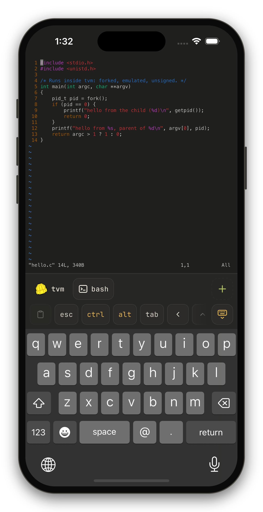
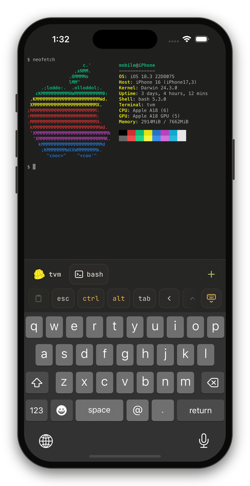
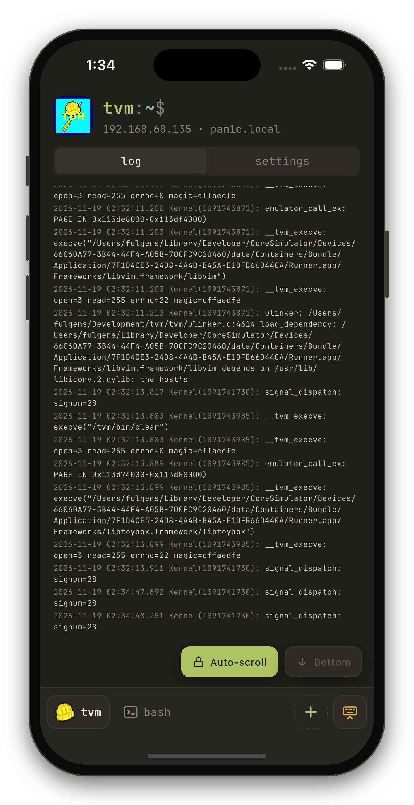
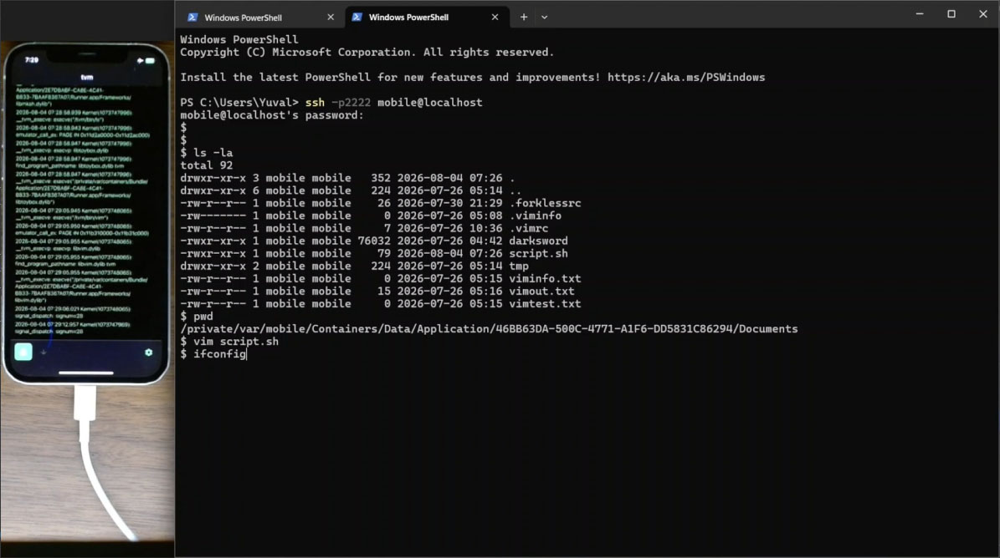

<div align="center">

<picture>
  <source media="(prefers-color-scheme: dark)" srcset="rsc/logo.jpg" />
  
</picture>

# tvm

**Bypass iOS security sandbox restrictions - no jailbreak or exploits required.**

SSH into an iPhone and run unsigned code in a shell with bash, vim, toybox, and git.

[](LICENSE)
[](https://github.com/yuvalino/tvm/releases)

[Website](https://tvm.yuvalino.com) ·
[Research paper](https://yuvalino.com/rage-against-the-sandbox)

<a href="https://apps.apple.com/app/id6807127809"></a>

<a href="https://discord.gg/kjkXcdByQm"></a>
<a href="https://x.com/jachashx"></a>

</div>


<p align="center">
  
  
  
</p>

## What's TVM?

It's a combination of two novel technologies: **Thread-based Process Virtualization** and **Hybrid CPU Emulation**.

**Thread-based Process Virtualization.** iOS applications cannot create child processes (call `fork()`) per Sandbox policy, and are unable to run shells because of it. We virtualize multi-processing by overriding `fork()` (and a bunch of other functions). Our `fork()` implements thread-groups that imitate the isolation of processes (file-descriptor tables, signal handlers, etc.). This allows open-source projects that rely on multi-process environments (such as bash, git, or dropbear) to run without any modification. The novelty here is the implementation of COW ([Copy-on-write](https://en.wikipedia.org/wiki/Copy-on-write)) semantics in a [single address space](https://en.wikipedia.org/wiki/Single_address_space_operating_system), since we cannot manage virtual memory mappings for threads individually. Memory ranges are duplicated with pointer fixup to imitate COW. A dedicated heap (`rmem.c`) and linker (`ulinker.c`) optimize this to be as fast as possible.

**Hybrid CPU Emulation.** Code signing on iPhones prevents the ability to run any executable that is not signed with Apple's services and shipped in its own application bundle. We use a pre-signed emulator to interpret unsigned code instructions without mapping them with `EXEC` protections or using [JIT](https://en.wikipedia.org/wiki/Just-in-time_compilation). The twist is integrating emulation into the host. Emulated memory operations are passed through to the host address space. When unsigned code calls any signed function, we configure the emulator to trap out and let the flow continue on the bare-metal CPU. When that code returns, we jump back to the emulator with the result. The outcome is hybrid execution that, to the program, appears continuous on a single CPU.

TVM is a dynamic library (`.so`, `.dylib`) targeting **arm64 iOS**, **arm64 macOS** and **x86-64 Linux** (**arm64 Android** soon), each covered by unit and integration tests. This project also provides two ready-made frontends: a Flutter app and a CLI executable.

## Getting Started

Three steps to a shell on your iPhone.

**1. Get the app**

Install [tvm from the App Store](https://apps.apple.com/app/id6807127809) and open it.

Or sideload it: download [`tvm.ipa`](https://github.com/yuvalino/tvm/releases/latest/download/tvm.ipa) from the [latest release](https://github.com/yuvalino/tvm/releases/latest). It is unsigned, so sign and install it with [Sideloadly](https://sideloadly.io) (macOS / Windows): plug in the iPhone, drag `tvm.ipa` into Sideloadly, enter your Apple ID and click *Start*. On the iPhone, enable *Settings → Privacy & Security → Developer Mode* (iOS 16+, restarts the phone), then trust your Apple ID under *Settings → General → VPN & Device Management*, and open tvm. With a free Apple ID a sideloaded app expires after 7 days; sideload it again to renew. Or [build it from source](#building-from-source).

**2. Connect**

```sh
ssh -p 2222 mobile@<device-name>.local  # password: alpine
```

Or over USB, with `iproxy` from [libimobiledevice](https://libimobiledevice.org):

```sh
iproxy 2222:2222 &
ssh -p 2222 mobile@localhost
```

**3. Change the password**

Anyone on your network can log in with the default password. Change it in the app (the *tvm* tab → *settings* → *Password*), then quit and reopen tvm for it to take effect.

That's bash, running on a stock iPhone. Knock yourself out.



## What's inside

bash 5.3, vim, nano, less, git, curl, sqlite3, the toybox utilities (`ls`, `cat`, `grep`, …), Apple's BSD userland (`ifconfig`, `netstat`), and `scp`/`sftp` through dropbear. Versions, build details and licenses are under [Third-party software](#third-party-software).

The login shell is `-bash`: it reads `/tvm/etc/profile`, which sources the
user's `~/.bashrc`, then `~/.bash_profile`; `/tvm/bin/sh` is bash invoked as
`sh` (POSIX mode) and is what `system(3)` and `#!/bin/sh` scripts get.

## Building from source

Requirements: CMake 3.16+, Ninja, Python 3, a C compiler. On macOS, also
`brew install gnu-sed openssl`, and for the apps Xcode and
[Flutter](https://docs.flutter.dev/get-started/install).

```sh
# TVM CLI executable (default)
python3 build.py

# The app (always release). Pick the platform with -a.
python3 build.py -a ios-arm64   -t flutter
python3 build.py -a macos-arm64 -t flutter

# Unit tests, examples
python3 build.py -t tests
python3 build.py -t examples
```

Without `-a` the platform is auto-detected (`linux-x64` or `macos-arm64`).
Output goes to `output/<platform>/`: executables and tests in `bin/`, libtvm
and the tools' frameworks in `lib/`. The iOS app is packaged as
`output/ios-arm64/bin/tvm.ipa`; the macOS app is
`flutter/build/macos/Build/Products/Release/tvm.app`.

### The app

`flutter/` is a Flutter app that embeds TVM and runs an SSH server (dropbear)
on-device. The TVM core is built as `libtvm.framework`, and
dropbear/bash/toybox/vim/curl/less/nano/sqlite3/git as frameworks too
(`lib<tool>.framework`). The rootfs is a per-platform Flutter asset
(`initrd.flutter.<arch>.cpio`). The native glue (`flutter/tvm/tvm_bindings.c`)
`dlopen`s libtvm, resolves `tvm_start` from it (see
[Embedding libtvm](#embedding-libtvm)) and calls it on a worker thread.

Signing: open `flutter/ios/Runner.xcworkspace` in Xcode and set your own team
and bundle identifier under *Signing & Capabilities* (the project is set up
with the author's). `iOS.entitlements` requests `increased-memory-limit`, so
that capability must be enabled on your App ID. To build the IPA unsigned,
for others to sign with their own identity, pass `--no-codesign` (iOS only).

## The CLI (macOS / Linux)

```sh
# Run a program in TVM
./output/linux-x64/bin/tvm <program> [args...]

# Run with kernel log output
./output/macos-arm64/bin/tvm --verbose <program>

# Custom initrc
./output/linux-x64/bin/tvm -i path/to/init.rc <program>

# Mount a CPIO archive
./output/linux-x64/bin/tvm -v /tvm:path/to/initrd.cpio <program>
```

The CLI launcher sets `HOME` to the directory it is started from, so per-user
files the guest writes (`.bash_history`, `.gitconfig`, `.dropbear/`, rc files)
land there, not in your real home directory.

### initrc

TVM runs an init script during `tvm_start()` before the main program starts. The script path is the `initrc` field of `struct tvm_config` (NULL = none); a relative path resolves against the init task's cwd and may live inside a config mount.

The CLI launcher maps its flags onto that field:

| Launcher flags | Behavior |
|---|---|
| (none) | Use `./init.rc` if it exists, silently skip otherwise |
| `-i <path>` / `--initrc <path>` | Use the given path, fail if not found |
| `-n` / `--no-initrc` | No initrc |

Commands:

```sh
mount <hostpath>:<guestpath>   # Mount a CPIO archive into the VFS
mount --bind <source>:<mountpoint>  # Bind a guest path (file or directory) over another
setenv <name>=<value>          # Set environment variable (overwrites)
setenv? <name>=<value>         # Set only if not already set
mkdir <path>                   # Create directory (mkdir -p semantics)
umask <mode>                   # Set per-task umask (octal, e.g. 022)
echo <message>                 # Print to kernel log
```

All arguments support variable expansion (`$VAR` or `${VAR}`).

See [INITRC.md](INITRC.md) for the full specification.

## Embedding libtvm

`libtvm` exposes one entry point, declared in `tvm/tvm.h`. It boots the VM and
execs the program inside it, on a thread of its own, and returns:

```c
#include "tvm.h"

struct tvm_mount initrd = { .path = "/tvm", .data = cpio_bytes, .size = cpio_len };
struct tvm_config cfg = {
    .log_fd  = STDOUT_FILENO,       // -1 disables kernel logging
    .cwd     = "/some/dir",         // NULL = host cwd
    .initrc  = "/tvm/etc/init.rc",  // NULL = none; may live inside a mount
    .mounts  = &initrd,
    .nmounts = 1,
};
char *argv[] = { "sh", "-l", NULL };
if (tvm_start("sh", argv, envp, &cfg))  // envp NULL = inherit; cfg NULL = all defaults
    perror("tvm_start");                // a pre-boot failure
// else sh runs as the init task, on a thread of its own; its exit ends the process
```

## Development

### Running on an iOS device

The device must be paired/trusted (over USB once, then usable over the network
tunnel). Use `xcrun devicectl` with the device name:

```sh
xcrun devicectl device install app --device <device-name> output/ios-arm64/bin/tvm.ipa
xcrun devicectl device process launch --terminate-existing --device <device-name> com.yuvalino.tvm  # or your bundle identifier
# then: ssh -p 2222 mobile@<device-name>.local   (default password: alpine)
```

Add `--console` to the launch to see the app's startup info and TVM kernel logs
on your Mac (the app writes them to `stderr` as well as its in-app console).
devicectl only connects the app's output on a fresh launch, which is why
`--terminate-existing` is needed.

### Tests

```sh
# Unit tests (rmem + tvm)
python3 build.py -t tests
./output/linux-x64/bin/tvm ./output/linux-x64/bin/test_tvm
./output/macos-arm64/bin/test_rmem

# Integration tests (pytest)
pip install pytest pexpect
python3 build.py -t initrd
pytest tests/test_integration.py

# Integration tests against the app's SSH server on a device
# (expects the bundle identifier com.yuvalino.tvm, see tests/test_integration.py)
pytest tests/test_integration.py --device <device-name> --backend flutter
```

UI tests of the Flutter app drive it over HTTP with
[frt](https://github.com/yuvalino/frt), which the app starts only when
launched with `FRT_PORT` set: tabs, settings, the log, and typing into the
shell tabs and reading their screens. They run against the macOS app, and
move its SSH server to a free port for the run (through its settings) and
back after:

```sh
pip install pytest aiohttp
python3 build.py -a macos-arm64 -t flutter
pytest tests/test_flutter.py
```

Test runner flags: `-l` list tests, `-k=TEST` filter, `-v` verbose, `-g` debug with gdb.

Small example programs live in `examples/`: `fork`, `snake`, `stopit`,
`hello_jmpbuf`, `gdb_backtrace`.

## Platforms

- Linux x86-64
- macOS arm64
- iOS arm64 (via the Flutter app)
- Android arm64 (planned)

## Third-party software

The programs and libraries tvm builds from `third_party/` (git submodules,
unpatched upstream unless noted), and their licenses.

| Program | Description | License |
|---|---|---|
| [unicorn](https://www.unicorn-engine.org/) | CPU emulator, linked into libtvm (TCI interpreter mode, no JIT) | GPLv2 |
| [dropbear](https://github.com/mkj/dropbear) | SSH server, client, and `scp` | MIT-style (see its LICENSE) |
| [bash](https://www.gnu.org/software/bash/) | GNU Bourne-Again Shell 5.3, the login shell and `/tvm/bin/sh` (configured via cache variables and `-D` overrides only; see `scripts/build_bash.sh`). Readline's terminal handling through the bundled ncurses and terminfo database. | GPLv3 |
| [toybox](http://landley.net/toybox/) | Unix utilities (`ls`, `cat`, `grep`, `id`, etc.) | 0BSD |
| [vim](https://github.com/vim/vim) | Text editor (see `scripts/build_vim.sh`). Terminal handling through the bundled ncurses and terminfo database. | Vim |
| [curl](https://curl.se/) | HTTP(S) client, TLS via OpenSSL; certificate verification through the OS trust store on macOS/iOS (Apple SecTrust), Mozilla's CA bundle on Linux. | curl |
| [OpenSSL](https://www.openssl.org/) | TLS/crypto library, statically linked into curl | Apache-2.0 |
| [less](https://greenwoodsoftware.com/less/) | Pager (less 710; `PAGER=less`, `LESS=-R` by default). Terminal handling through the bundled ncurses and terminfo database. | GPLv3 / Less License |
| [nano](https://www.nano-editor.org/) | GNU nano 9.2 text editor (built from git with the pinned gnulib; `EDITOR=nano` by default unless set). Syntax highlighting from its own definitions via `/tvm/etc/nanorc`. | GPLv3 |
| [ncurses](https://invisible-island.net/ncurses/) | ncurses 6.6 (wide-char), statically linked into bash, vim, less and nano on every platform; a small terminfo database (xterm, screen, tmux, vt100/vt220, linux, ansi, dumb and a few terminal emulators' entries: `TERMINFO_ENTRIES` in `scripts/CMakeLists.txt`) is compiled from its `terminfo.src` into `/tvm/share/terminfo` (`TERMINFO`); `/tvm/etc/bash.bashrc` maps any other `TERM` to xterm-256color. | MIT |
| [sqlite3](https://sqlite.org/) | SQLite 3.53.4 command-line shell (amalgamation generated by its own configure/make; see `scripts/build_sqlite.sh`). FTS4/FTS5, R*Tree/geopoly, JSON, math functions, dbstat/dbpage/stmt/bytecode virtual tables and zlib (`.archive`) compiled in; no extension loading (`SQLITE_OMIT_LOAD_EXTENSION`, there is no dlopen). Plain POSIX file locking on every platform, emulated between tasks by TVM's `fcntl()`. | Public domain |
| [linenoise](https://github.com/antirez/linenoise) | Line editing and history for the sqlite3 shell (statically compiled in) | BSD-2-Clause |
| [git](https://git-scm.com/) | Git 2.55.0 (build knobs in `third_party/configs/git_config.mak`, see `scripts/build_git.sh`). HTTPS through the static libcurl/OpenSSL of the curl tool (Apple SecTrust on macOS/iOS, no CA file needed); the curl helpers `git-remote-http` (`https`, `ftp`, `ftps` are links to it) and `git-http-fetch` are upstream's separate programs in the exec path `/tvm/libexec/git-core`, together with the shell-script helpers; templates in `/tvm/share/git-core/templates`, system config `/tvm/etc/gitconfig`. Pages through `less` (`PAGER`) and edits commit messages in `nano` (`EDITOR`); hooks and `!` aliases run under `/tvm/bin/sh`. No gettext, expat (WebDAV `http-push`), pcre, Perl/Python/Tcl commands, fsmonitor daemon or ssh transport. | GPLv2 |
| Apple *_cmds | BSD userland from [apple-oss-distributions](https://github.com/apple-oss-distributions) (`adv_cmds`, `network_cmds`, `system_cmds`, `diskdev_cmds`: `ifconfig`, `netstat`, `ps`, `sysctl`, etc.) | APSL 2.0 / BSD |

### Licensing notes

tvm's own code is MIT ([LICENSE](LICENSE)). unicorn is GPLv2 and statically
linked into libtvm, so the libtvm, CLI and app binaries built from this
repository are covered by GPLv2 as a whole.

bash, nano and less are GPLv3, git is GPLv2; everything else is permissively
licensed. Nothing links against them — each is shipped as a separate program
(`/tvm/bin/bash`, `libbash.framework` in the apps, and likewise for nano, less
and git) — so the GPL covers those binaries and their sources only.

One caveat: git is GPLv2-only, and its image statically links libcurl and
OpenSSL 3 (Apache-2.0) for HTTPS, a combination the FSF considers incompatible
with GPLv2 (Debian builds git against GnuTLS for this reason); review that
before redistributing the git binaries.

## License

tvm's own code is MIT ([LICENSE](LICENSE)). The binaries include unicorn
(GPLv2), and the bundled programs keep their own licenses; see
[Third-party software](#third-party-software).
